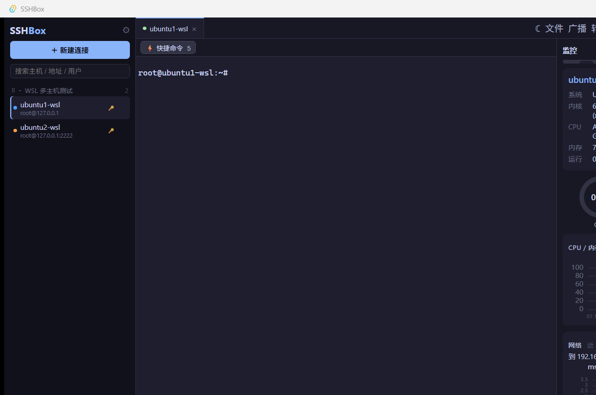

# SSHBox

**Windows / Linux 桌面 SSH 终端 + 虚拟机实时监控工具**（类 MobaXterm / Xshell 的轻量替代）

Windows 版：Tauri 2 + Vue 3 + Rust 原生桌面应用，安装包约 5 MB，内存占用远低于 Electron 系终端。
Linux 版：同一套 Rust 后端 + Vue 前端，装 Electron 壳（原因见[下文](#linux)）。



## 功能

- **SSH 终端**：多会话标签页、保存主机、一键连接、命令只填入终端不自动执行（回车由你按）
- **实时监控**：侧边栏主机状态（在线/离线）、CPU / 内存 / 磁盘 / 负载曲线、网络时延与丢包（默认网关实测）、告警与解除事件
- **AI 助手**：接入 OpenAI 兼容接口（含 Ollama 本地模型），生成命令/解释输出/分析故障，密钥存 Windows 凭据管理器，明文不回传不落盘
- **故障日志**：崩溃现场直写（panic hook + 前端全局异常捕获）、异常退出标记按 PID 追踪、启动环境快照（OS / WebView2 / 配置）、日志自动轮转（默认 5 MB，`SSHBOX_LOG_MAX_BYTES` 可覆盖）
- **报告**：监控数据导出自包含 HTML 报告（无 CDN 依赖）

## 安装

从 [Releases](https://github.com/Xingzhewujiang2017/sshbox-terminal/releases) 下载：

**Windows**

- `SSHBox_x.x.x_x64-setup.exe` — NSIS 安装包（需要 [WebView2 运行时](https://developer.microsoft.com/microsoft-edge/webview2/)，Windows 11 自带）
- `SSHBox-x.x.x-portable.exe` — 免安装绿色版，双击即用

数据存 `%APPDATA%\sshbox\`（主机列表 / 设置 / 历史 SQLite），日志在 `%LOCALAPPDATA%\com.z.sshbox\logs\`。

**Linux**

- `SSHBox-x.x.x-linux-x64.tar.gz` — 解压即用（自带 Chromium，不依赖 WebKitGTK / libsoup）

```bash
tar xzf SSHBox-0.8.0-linux-x64.tar.gz
cd SSHBox-linux-x64
./check-deps.sh                    # 自检
./start.sh                         # 后台启动（日志 ~/.config/sshbox/electron.log）
./install-desktop.sh --desktop     # 加进应用菜单 + 桌面图标（不需要 root）
```

数据存 `~/.config/sshbox/`；容器里 `~` 不持久时用 `SSHBOX_HOME=/data/sshbox ./start.sh` 保住主机列表与历史。

<a id="linux"></a>
> **为什么 Linux 用 Electron 而不是 Tauri**：目标机（openEuler 系）WebKitGTK 冻结在 2.38.2，
> 而 Tauri v2 硬性要求 ≥ 2.40；且该机 libsoup3 自身损坏（依赖的 nghttp2 符号缺失），
> 加载它的程序启动即崩。Electron 自带 Chromium，不碰 webkit 与 libsoup。

## 从源码构建

环境：Rust（stable）+ Node.js 22+ + Windows（Windows 版）/ Linux（Linux 版）。

```bash
npm install
npm run tauri build        # 出包：src-tauri/target/release/sshbox.exe + NSIS 安装包
```

> ⚠️ **构建铁律**：release 构建必须带 `custom-protocol` feature。
> `npm run tauri build` 会自动传；但裸 `cargo build --release` **不会**，产物会导航到 devUrl 整页白屏（ERR_CONNECTION_REFUSED）。
> 裸 cargo 构建请用：
> ```bash
> cd src-tauri && cargo build --release --features custom-protocol
> ```
> 构建后自查：`grep cargo:dev target/release/build/tauri-*/output` 最新一条应为 `cargo:dev=false`。

开发模式：`npm run tauri dev`（前端热更新，Vite :1420）。

Linux 版（Electron 壳）的构建脚本在 `.dev/`：`build_linux.sh`（WSL/Linux 上编 Rust 后端，注意 `CARGO_TARGET_DIR` 要指向 Linux 原生目录，别在 `/mnt/d` 上编）、`pack_electron.sh`（打 tar.gz）。

## 测试

```bash
npx vue-tsc --noEmit        # 前端类型检查
npm run test:ts             # 前端单测
cd src-tauri && cargo test --lib   # Rust 单测（142 项）
```

端到端冒烟测试（CDP 驱动真实 UI，含 WSL/虚拟机的 SSH 连通性用例）在 `.dev/` 下，未随仓库分发。

## 技术栈

| 层 | 选型 |
|---|---|
| 桌面框架 | Windows：Tauri 2（Rust + WebView2）；Linux：Electron 壳（自带 Chromium） |
| 前端 | Vue 3 + TypeScript + Vite |
| 后端 | Rust（axum 风格命令层 / 监控采样 / SQLite 历史），业务层与桌面壳解耦 |
| 采集口径 | 只读 `/proc`、`/sys` 与命令输出；端口检查走默认网关实测，拿不到就不显示，不编造 `0 ms` |

## 许可

[MIT](LICENSE) © 2026 sshbox contributors